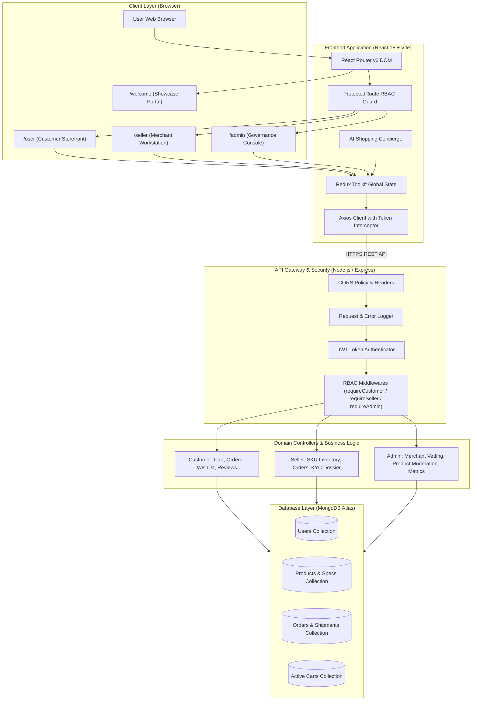

# 🛒 TheStore — Enterprise Multi-Role E-Commerce Marketplace

[](https://github.com/Sriram-Harshit/The-Store/actions/workflows/ci.yml)
[](https://vitejs.dev/)
[](https://redux-toolkit.js.org/)
[](https://nodejs.org/)
[](https://www.mongodb.com/)
[](https://vercel.com/)

**TheStore** is a production-grade, full-stack **MERN E-Commerce Marketplace** engineered with strict **Role-Based Access Control (RBAC)**, symmetric URL route isolation (`/user`, `/seller`, `/admin`), an interactive **AI Shopping Concierge**, a standalone **Welcome Portal Showcase** (`/welcome`), deep Flipkart/Amazon-style **Technical Specifications**, and live merchant telemetry.

---

## 📑 Table of Contents
1. [In-Depth System Architecture](#-in-depth-system-architecture)
2. [Role-Based Access Control & Routing Isolation](#-role-based-access-control--routing-isolation)
3. [Welcome Portal Showcase (`/welcome`)](#-welcome-portal-showcase-welcome)
4. [Frontend Client (`frontend/`)](#-frontend-client-frontend)
   - [Tech Stack & Architecture](#frontend-tech-stack)
   - [Directory Structure](#frontend-directory-structure)
   - [Core Features & AI Assistant](#frontend-core-features)
   - [Client Scripts](#frontend-scripts)
5. [Backend API (`backend/`)](#-backend-api-backend)
   - [Tech Stack & Architecture](#backend-tech-stack)
   - [Directory Structure](#backend-directory-structure)
   - [Database Schemas & Data Model](#backend-database-schemas)
   - [REST API Endpoints & RBAC Matrix](#backend-api-endpoints)
   - [Backend Scripts & Testing](#backend-scripts)
6. [Demo Test Credentials](#-demo-test-credentials)
7. [Vercel Deployment Guide](#-vercel-deployment-guide)
8. [Environment Variables (`env-template.txt`)](#-environment-variables-env-templatetxt)
9. [Local Development Guide](#-local-development-guide)
10. [CI/CD & Quality Gates](#-cicd--quality-gates)

---

## 🏛 In-Depth System Architecture

TheStore employs a decoupled client-server architecture with hardened API gateways, state isolation, and zero-trust route guards:



### Architectural Highlights:
1. **Zero-Trust Role-Based Isolation:**
   - Both Frontend and Backend enforce strict role boundaries. Customers cannot access merchant or admin interfaces. Sellers cannot access customer carts or admin controls. Admins cannot access consumer cart operations.
2. **Symmetric URL Route Prefixes:**
   - Customer Portal: strictly anchored at `/user` (`/user`, `/user/cart`, `/user/orders`, `/user/profile`).
   - Seller Hub: strictly anchored at `/seller` (`/seller`, `/seller?tab=inventory`, etc.).
   - Admin Console: strictly anchored at `/admin` (`/admin`, `/admin?tab=sellers`, etc.).
3. **Session Clearing & Account Switcher:**
   - If an authenticated user of one role attempts to navigate to a portal reserved for another role, `ProtectedRoute` intercepts the request and presents a modal restriction card with one-click session reset and direct navigation to the corresponding login.
4. **Performance & Caching:**
   - Lean read queries (`.lean()`) and HTTP caching headers (`Cache-Control: public, max-age=300`) ensure low database latency.
   - Client bundle built with Vite 7 tree-shaking and gzip compression.

---

## 🔒 Role-Based Access Control & Routing Isolation

| User Role | Allowed Frontend Paths | Allowed Backend API Paths | Restricted Areas |
|:---|:---|:---|:---|
| **Guest / Visitor** | `/`, `/welcome`, `/login`, `/register`, `/seller/login`, `/admin/login` | `/api/product/*`, `/api/users/login`, `/api/users/register` | All Cart, Orders, Seller, Admin routes (HTTP 401) |
| **Customer (`user`)** | `/user`, `/user/cart`, `/user/orders`, `/user/profile` | `/api/cart/*`, `/api/orders/*`, `/api/wishlist/*`, `/api/users/profile/*` | Seller Hub, Admin Console (HTTP 403 Forbidden) |
| **Seller (`seller`)** | `/seller`, `/seller/*` | `/api/seller/dashboard`, `/api/seller/products`, `/api/seller/orders`, `/api/seller/documents` | Customer Cart, Admin Console (HTTP 403 Forbidden) |
| **Admin (`admin`)** | `/admin`, `/admin/*` | `/api/admin/overview`, `/api/admin/sellers/*`, `/api/admin/products/*`, `/api/admin/users/*` | Customer Personal Cart (HTTP 403 Forbidden) |

---

## 🌟 Welcome Portal Showcase (`/welcome`)

A dedicated entry portal designed for reviewers, recruiters, and evaluators to inspect the platform:
- **Clean Aesthetic:** Header, Footer, and Floating AI Concierge are automatically hidden to present an uncluttered interface.
- **3 Portal Showcase Cards:**
  1. **Customer Store** (`/user`) — Live retail shopping catalog, search, cart, checkout, order history, AI shopping assistant.
  2. **Seller Hub** (`/seller`) — Merchant telemetry, inventory stock updates, product creation, KYC dossier compliance.
  3. **Admin Console** (`/admin`) — Merchant approval queue, product moderation, user role governance, platform gross metrics.
- **Embedded Test Credentials:** Each card displays the pre-seeded demo login and password for instantaneous testing.

---

## 🎨 Frontend Client (`frontend/`)

### Frontend Tech Stack
- **Framework:** React 18 (Functional components, hooks)
- **Build Tool:** Vite 7 (Hot Module Replacement, fast build pipeline)
- **State Management:** Redux Toolkit (`authSlice`, `productsSlice`, `cartSlice`, `ordersSlice`, `searchSlice`)
- **Routing:** React Router DOM v6 with custom `ProtectedRoute` and `AuthRoute`
- **Styling:** Vanilla CSS with custom design system tokens, responsive glassmorphism, Bootstrap Icons
- **HTTP Client:** Axios with centralized base URL and Bearer token handling

### Frontend Directory Structure
```text
frontend/
├── public/                       # Static public assets (SVG icons, favicons)
├── src/
│   ├── Components/
│   │   ├── admin/                # Admin Console & supervisor portal
│   │   │   ├── AdminPortal.jsx   # Tabbed control room (Metrics, Sellers, Products, Users)
│   │   │   ├── AdminLogin.jsx    # Dedicated Administrator login
│   │   │   └── AdminNavbar.jsx   # Dedicated Administrator navbar
│   │   ├── seller/               # Merchant Workstation
│   │   │   ├── SellerPortal.jsx  # Inventory, Orders, KYC Documents, Analytics
│   │   │   └── SellerLogin.jsx   # Dedicated Merchant login
│   │   ├── customer/             # Consumer Storefront & Workflows
│   │   │   ├── Home/             # Product catalog grid, category bar, deals
│   │   │   ├── Cart/             # Stock-aware cart calculation & checkout
│   │   │   ├── OrderManagement/  # Order history receipts & status timeline
│   │   │   ├── UserProfile/      # Account settings & address management
│   │   │   ├── Login/            # Customer authentication
│   │   │   └── Register/         # Customer registration
│   │   └── common/               # Shared Application Components
│   │       ├── Welcome/          # Standalone 3-portal showcase (/welcome)
│   │       ├── Header/           # Adaptive role navbar
│   │       ├── Footer/           # Enterprise marketplace footer
│   │       ├── Chatbot/          # 3-Step AI Discovery Concierge
│   │       ├── ProductDetails/   # Deep technical specs modal & reviews
│   │       └── NotFound/         # 404 handler
│   ├── config/                   # Centralized API URL resolver (config.jsx)
│   ├── routes/
│   │   ├── ProtectedRoute.jsx    # RBAC route interceptor & restriction modal
│   │   └── AuthRoute.jsx         # Guest-only route guard
│   ├── store/                    # Redux store configuration & domain slices
│   ├── utils/                    # Product images, API logger, notification toasts
│   ├── App.jsx                   # Master route configuration
│   ├── index.css                 # Global CSS design tokens
│   └── main.jsx                  # React DOM entry point
├── vercel.json                   # Vercel SPA client rewrite configuration
├── package.json
└── vite.config.js
```

### Frontend Core Features
- **AI Shopping Concierge:** 3-step discovery wizard guiding shoppers from product requirement ➔ price budget ➔ intended use, computing match scores (e.g., `⭐ 98% Match`). Automatically hidden on `/welcome`, `/admin`, and `/seller`.
- **Deep Technical Specifications Modal:** Categorized display specs (Resolution, Refresh Rate), computing hardware (CPU, RAM, Storage, Battery), clothing fabrics, book details, and verified review submissions.
- **Adaptive Header:** Adapts navigation links and branding according to whether the user is a Customer, Seller, or Admin. Intrusive role tags are removed for a sleek layout.

### Frontend Scripts
```bash
# Start local development server (http://localhost:3000)
npm run dev

# Compile optimized production bundle
npm run build

# Preview production build locally
npm run preview
```

---

## ⚙️ Backend API (`backend/`)

### Backend Tech Stack
- **Runtime:** Node.js (v18+)
- **Framework:** Express.js 4
- **Database:** MongoDB Atlas (Cloud)
- **ODM:** Mongoose 8
- **Authentication:** JSON Web Tokens (JWT) & Bcrypt password hashing
- **Reliability:** Built-in DNS resolver fallback (`8.8.8.8`, `1.1.1.1`) for resilient Windows Atlas connectivity

### Backend Directory Structure
```text
backend/
├── src/
│   ├── admin/                    # Platform administration domain
│   │   ├── adminControllers.js   # Analytics, seller approval, product moderation
│   │   └── adminRoutes.js        # Protected /api/admin routes
│   ├── seller/                   # Merchant domain
│   │   ├── sellerControllers.js  # Inventory stock, order dispatch, KYC documents
│   │   └── sellerRoutes.js       # Protected /api/seller routes
│   ├── customer/                 # Consumer shopping domain
│   │   ├── controllers/          # User, cart, orders, wishlist, products
│   │   └── routes/               # Customer endpoints
│   ├── common/                   # Shared infrastructure
│   │   ├── dbconfig/             # Database connection & catalog seeders
│   │   └── middleware/           # authMiddleware, rbacMiddleware, loggerMiddleware
│   ├── models/                   # Mongoose schemas (User, Product, Order, Cart, Wishlist)
│   └── testRoutes.js             # Comprehensive 36-route automated audit suite
├── server.js                     # Express server & CORS configuration
├── vercel.json                   # Vercel Serverless Function deployment config
├── package.json
└── .env                          # Local secrets (never committed to Git)
```

### Backend Database Schemas
- **User Schema (`userModel.js`):** `name`, `email`, `password`, `accountType` (`user` | `seller` | `admin`), `sellerStatus` (`pending` | `approved` | `rejected`), `sellerProfile`, `addresses`.
- **Product Schema (`productModel.js`):** `name`, `price`, `category`, `stock`, `rating`, `specs` (subdocument with Display, Processor, Memory, Audio, Material), `highlights` (4 bullet points), `reviews`, `sellerId`, `status` (`pending` | `approved`).
- **Order Schema (`orderModel.js`):** `userId`, `items`, `totalAmount`, `shippingAddress`, `status` (`Placed` | `Processing` | `Shipped` | `Delivered` | `Cancelled`), `paymentMethod`.
- **Cart Schema (`cartModel.js`):** `userId`, `items: [{ productId, quantity }]`.

### Backend API Endpoints & RBAC Matrix
| Domain | Method | Endpoint | Access Level | Description |
|:---|:---|:---|:---|:---|
| **Public** | `GET` | `/` | All | Server health check |
| **Catalog** | `GET` | `/api/product/products` | All | Fetch all approved products |
| **Catalog** | `GET` | `/api/product/search` | All | Query catalog by keyword, category, price |
| **Catalog** | `GET` | `/api/product/:id` | All | Get single product with specs & reviews |
| **Review** | `POST` | `/api/product/:id/review` | Authenticated | Submit star rating and review comment |
| **Auth** | `POST` | `/api/users/register` | All | Register consumer account |
| **Auth** | `POST` | `/api/users/login` | All | Authenticate user & issue JWT |
| **Customer**| `GET` | `/api/users/profile/profileDetails`| Customer | Get customer profile & addresses |
| **Customer**| `GET` | `/api/cart/getcart/user` | Customer Only | Fetch active shopping cart |
| **Customer**| `POST`| `/api/cart/cartUpdate` | Customer Only | Update item quantities or add product |
| **Customer**| `GET` | `/api/orders/getOrders` | Customer Only | Retrieve customer order history |
| **Seller** | `GET` | `/api/seller/dashboard` | Seller / Admin | Real-time merchant telemetry & sales |
| **Seller** | `GET` | `/api/seller/products` | Seller Only | Retrieve merchant SKU inventory |
| **Seller** | `POST`| `/api/seller/documents` | Seller Only | Submit merchant KYC & tax dossier |
| **Admin** | `GET` | `/api/admin/overview` | Admin Only | Platform-wide analytics & revenue |
| **Admin** | `GET` | `/api/admin/sellers` | Admin Only | List all registered seller applications |
| **Admin** | `PATCH`| `/api/admin/sellers/:id/status`| Admin Only | Approve or reject seller application |
| **Admin** | `GET` | `/api/admin/products` | Admin Only | Moderate catalog items |
| **Admin** | `GET` | `/api/admin/users` | Admin Only | Platform user accounts & role management |

### Backend Scripts
```bash
# Start backend in development mode with nodemon
npm run dev

# Start backend in production mode
npm start

# Run automated 36-route audit across all 4 user roles
node src/testRoutes.js

# Wipe and reseed clean database with full catalog & test accounts
node src/dbconfig/seedData.js
```

---

## 🔑 Demo Test Credentials

The database includes pre-configured accounts for testing each portal and permission tier:

| Role | Email | Password | Target Portal | Capabilities |
|:---|:---|:---|:---|:---|
| **Platform Admin** | `admin@thestore.com` | `admin123` | [`/admin`](http://localhost:3000/admin) | Full merchant vetting, product moderation, user role controls, platform revenue metrics |
| **Operations Admin** | `opsadmin@thestore.com` | `admin123` | [`/admin`](http://localhost:3000/admin) | Secondary administrator oversight & catalog audit |
| **Approved Seller** | `apextech@thestore.com` | `seller123` | [`/seller`](http://localhost:3000/seller) | Merchant dashboard, stock inventory, new product creation, KYC dossier compliance |
| **Pending Seller** | `nordic@thestore.com` | `seller123` | [`/seller`](http://localhost:3000/seller) | KYC submitted; displays pending verification banner |
| **Rejected Seller** | `dropship@thestore.com` | `seller123` | [`/seller`](http://localhost:3000/seller) | Displays admin corrective action notice |
| **Customer Buyer** | `customer@thestore.com` | `user123` | [`/user`](http://localhost:3000/user) | Full retail shopping, cart calculations, orders receipts, AI shopping assistant |

---

## 🚀 Vercel Deployment Guide

The repository includes pre-configured `vercel.json` files for both frontend and backend.

### Option A: Deploying as Two Independent Vercel Projects (Recommended)

#### 1. Deploy the Backend API:
1. In your [Vercel Dashboard](https://vercel.com/dashboard), click **Add New Project** and import `The-Store`.
2. In **Project Settings**:
   - **Root Directory**: `backend`
   - **Framework Preset**: Other
3. Add the **Environment Variables** (see [`env-template.txt`](file:///c:/Users/srira/Downloads/The-Store/env-template.txt)):
   - `MONGO_URI`: `your_mongodb_atlas_connection_string`
   - `SESSION_SECRET`: `your_strong_jwt_secret`
   - `NODE_ENV`: `production`
   - `CORS_ORIGIN`: `https://your-frontend-domain.vercel.app`
4. Click **Deploy**. Note your backend URL (e.g. `https://your-backend.vercel.app`).

#### 2. Deploy the Frontend Client:
1. Click **Add New Project** and import `The-Store` again.
2. In **Project Settings**:
   - **Root Directory**: `frontend`
   - **Framework Preset**: Vite
   - **Build Command**: `npm run build`
   - **Output Directory**: `dist`
3. Add the **Environment Variables**:
   - `VITE_API_URL`: `https://your-backend.vercel.app/api`
   - `VITE_ENV`: `production`
4. Click **Deploy**.

The pre-configured [`frontend/vercel.json`](file:///c:/Users/srira/Downloads/The-Store/frontend/vercel.json) rewrites all client routes to `/index.html`, ensuring clean browser reloads on `/welcome`, `/user`, `/seller`, and `/admin`.

---

## 📄 Environment Variables (`env-template.txt`)

A complete template is provided in the repository root at [`env-template.txt`](file:///c:/Users/srira/Downloads/The-Store/env-template.txt):

```env
# BACKEND (.env)
PORT=5000
NODE_ENV=production
MONGO_URI=mongodb+srv://<username>:<password>@cluster0.mongodb.net/TheStore?retryWrites=true&w=majority
SESSION_SECRET=your_jwt_strong_secret_key_change_in_production
JWT_EXPIRES_IN=30d
CORS_ORIGIN=https://your-frontend-domain.vercel.app

# FRONTEND (.env)
VITE_API_URL=https://your-backend-api.vercel.app/api
VITE_ENV=production
```

---

## 💻 Local Development Guide

### 1. Clone Repository
```bash
git clone https://github.com/Sriram-Harshit/The-Store.git
cd The-Store
```

### 2. Set Up Backend
```bash
cd backend
npm install
# Create .env based on env-template.txt
npm run dev
# Backend running at http://localhost:5000
```

### 3. Set Up Frontend
```bash
cd ../frontend
npm install
npm run dev
# Frontend running at http://localhost:3000
```

### 4. Visit the Welcome Portal
Open your browser to:
```
http://localhost:3000/welcome
```

---

## 🧪 CI/CD & Quality Gates

The automated **GitHub Actions CI Workflow** ([`.github/workflows/ci.yml`](file:///c:/Users/srira/Downloads/The-Store/.github/workflows/ci.yml)) runs on every push and pull request to `main`:
1. **Frontend Build & Lint:** Executes `npm ci` and `npm run build` to verify production compilation with zero errors.
2. **Backend Validation:** Executes `npm ci` and `node -c server.js` to ensure complete syntax and runtime integrity without hanging on remote secrets.

---

## 👨‍💻 Author
**Sri Ram Harshit**  
*Full Stack Developer (MERN Stack)*
